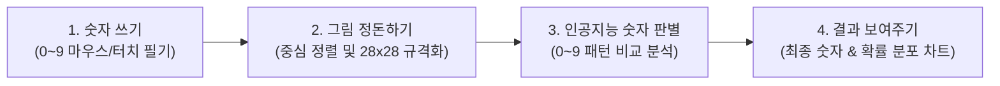

# 📝 손글씨 숫자 인식 웹 앱 (Handwriting Digit Recognition Web App) 요구사항 명세서

> **문서 상태**: 요구사항 1차 개정 (v0.2 - 인식 대상: 0~9 숫자 확정)  
> **최종 수정일**: 2026-10-14  
> **대상 독자**: 비전공자 및 기획자/개발자  

---

## 1. 프로젝트 개요 💡

### 1.1 서비스 소개
사용자가 웹 화면의 '디지털 스케치북(캔버스)'에 마우스나 손가락으로 **0부터 9까지의 숫자**를 필기하면, 인공지능(AI)이 필기 모양을 분석하여 해당 숫자를 즉시 판별하고 정확도(신뢰도)와 함께 컴퓨터 텍스트로 변환해 주는 웹 애플리케이션입니다.

### 1.2 기획 목적
- 복잡한 프로그램 설치 없이 웹 브라우저(PC/모바일/태블릿)에서 누구나 손쉽게 0~9 손글씨 숫자를 쓰고 AI 인식 성능을 체험할 수 있도록 합니다.
- 직관적인 드로잉 인터페이스와 0~9 확률 바 차트 등의 시각화 요소를 통해 사용자가 판별 과정을 쉽고 흥미롭게 이해할 수 있는 환경을 제공합니다.

---

## 2. 알기 쉬운 동작 원리 ⚙️
*(어려운 기술 용어 대신 일상 비유로 설명합니다)*

1. **1단계 - 숫자 쓰기**: 사용자가 캔버스에 0부터 9까지의 숫자 중 하나를 마우스나 터치로 그립니다.
2. **2단계 - 그림 정돈하기 (전처리)**: 컴퓨터가 숫자의 무게중심을 맞추고, 인공지능이 가장 잘 알아볼 수 있는 표준 크기(28×28 픽셀)로 그림을 다듬습니다.
3. **3단계 - 인공지능 숫자 판별**: 인공지능이 0부터 9까지 각 숫자와 얼마나 닮았는지를 비교하여 0~9 각각의 확률을 계산합니다.
4. **4단계 - 결과 안내**: 가장 높은 확률의 숫자(예: **"7"**)를 크고 또렷하게 표시하고, 0부터 9까지의 상세 확률 차트를 함께 보여줍니다.

---

## 3. 핵심 기능 요구사항 🎯

### 3.1 화면 그리기 영역 (스케치북 / 캔버스)
- **자유로운 필기**: PC 마우스 드래그, 모바일/태블릿 터치 제스처를 모두 부드럽게 지원합니다.
- **펜 도구 조절**:
  - 펜 굵기 조절 (가늘게, 보통, 두껍게 슬라이더 또는 프리셋 버튼)
  - 펜 색상 선택 (기본: 검정색 또는 다크 모드용 화이트 잉크)
- **수정 및 지우기**:
  - `한 획 되돌리기(Undo)`: 방금 잘못 그은 획 하나 취소
  - `부분 지우개`: 원하는 부분만 선택적으로 지우기
  - `전체 지우기(Clear)`: 한 번에 스케치북을 깨끗한 백지로 초기화
- **중앙 가이드선 (선택 기능)**: 숫자를 가운데에 균형 있게 쓸 수 있도록 도와주는 연한 안내선(가이드 그리드) 토글

### 3.2 숫자 인식 및 판별 기능
- **인식 대상**: **아라비아 숫자 (0, 1, 2, 3, 4, 5, 6, 7, 8, 9)** 단일 숫자
- **인식 실행 방식**:
  - **수동 인식**: 숫자를 다 쓴 뒤 `[숫자 인식하기]` 버튼을 눌러 결과 도출
  - **스마트 자동 인식 (선택 옵션)**: 숫자를 쓰고 손을 떼면 약 0.4초 뒤 자동으로 즉시 판별
- **결과 표시**:
  - **인식 결과 및 정확도 나란히 표시**:
    - "인식결과" 레이블/숫자 바로 옆에 정확도(신뢰도) 수치를 나란히 함께 노출 (예: **"인식결과: 7 (98.4%)"** 또는 **[인식결과] 7 · 정확도 98.4%**)
    - 사용자가 시선을 따로 옮길 필요 없이 판별된 숫자와 신뢰도를 한눈에 직관적으로 파악할 수 있는 인라인(Inline) 레이아웃 적용
  - **0~9 확률 분포 바 그래프**: 0부터 9까지 각 숫자의 유사도 비율을 한눈에 비교할 수 있는 인터랙티브 차트
  - **후보군(Top 3) 추천**: 1등, 2등, 3등 후보 숫자와 확률 간략 표시 (예: 1등 '7' 92%, 2등 '1' 6%, 3등 '2' 1%)

### 3.3 사용자 편의 기능
- **원클릭 복사**: 인식된 숫자를 클릭 한 번으로 복사하여 클립보드에 저장
- **음성 읽기 (TTS, 선택)**: 인식된 숫자를 음성으로 읽어주는 기능 (예: "칠" 또는 "Seven")
- **최근 기록 (히스토리)**: 방금 전 인식했던 손글씨 썸네일과 인식 결과를 하단에 카드 형태로 보관 (새로고침 전까지 유지)
- **다크 모드 / 라이트 모드**: 눈이 편안한 세련된 다크 테마 및 깔끔한 라이트 테마 전환

---

## 4. 화면 구성 및 디자인 가이드 📱💻

1. **상단 (헤더)**:
   - 앱 로고 및 이름 ("AI Digit Studio", "손글씨 숫자 인식기")
   - 테마 전환 버튼 (다크/라이트 모드) 및 가이드선 켜기/끄기
2. **중앙 좌측 / 상단 (그리기 패널)**:
   - 큼직하고 여유로운 사각형 캔버스 영역 (정방형 1:1 비율)
   - 하단 툴바: [펜] [지우개] [되돌리기] [모두 지우기] [인식하기]
   - 펜 굵기 조절 슬라이더
3. **중앙 우측 / 하단 (결과 패널)**:
   - **대형 결과 카드**:
     - 상단 또는 메인 텍스트: **"인식결과: [숫자]"** 바로 옆에 **정확도 배지/수치(예: 98.4%)** 나란히 배치
     - 하이라이트된 대형 숫자 폰트와 눈에 띄는 정확도 컬러 태그 (예: 90% 이상 초록/민트, 70% 이상 주황)
   - 0부터 9까지의 실시간 확률 막대 그래프
   - [복사하기], [소리로 듣기] 빠른 액션 버튼
4. **하단 (최근 작업 기록)**:
   - 내가 방금 썼던 숫자 손글씨 썸네일과 인식 결과(숫자 + 정확도) 타임라인 리스트

---

## 5. 단계별 개발 로드맵 🗺️

| 단계 | 목표 | 주요 내용 | 진행 상태 |
| :--- | :--- | :--- | :---: |
| **1단계 (현재 목표)** | **손글씨 숫자(0~9) 인식 전용 웹 앱** | 브라우저 기반 고정밀 숫자 인식(캔버스 드로잉, 0~9 확률 차트, 히스토리, 반응형 UI) | **확정 및 착수 준비** |
| **2단계 (기능 확장)** | **사진 업로드 & 연속 숫자 인식** | 종이에 쓴 숫자 사진 업로드 기능 및 두 자리 이상의 연속 숫자 인식 | 추후 확장 |
| **3단계 (영역 확장)** | **알파벳 / 문자 확장** | 영문 알파벳(A~Z) 또는 기호 인식으로 모델 확장 | 추후 확장 |

---

## 6. 확정 사항 및 다음 진행 단계 📋

- [x] **인식 대상 범위**: **0~9 아라비아 숫자 손글씨 전용**으로 확정 완료
- [ ] **입력 방식 옵션**:
  - `기본`: 웹 화면 캔버스에 직접 그리기 (필수 구현)
  - `추가 선택`: 종이에 쓴 숫자 사진 파일(PNG/JPG) 업로드 기능도 1단계에 함께 포함할지 여부
- [ ] **인식 실행 기본값**:
  - `버튼 클릭 방식` vs `손을 떼면 0.4초 후 자동 인식 (토글 지원)`
